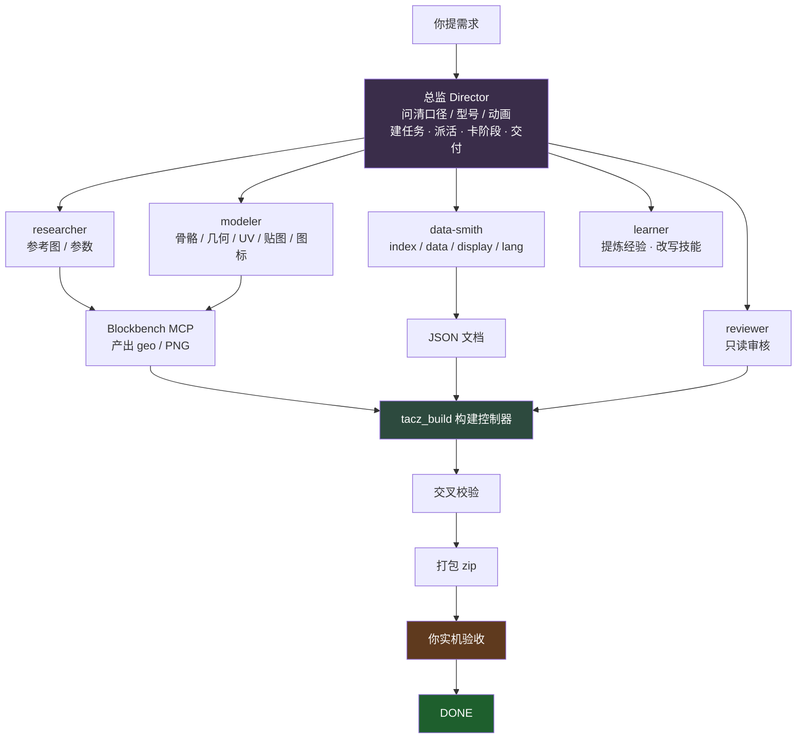

# 关于 TACZ 枪包工坊

## 一句话

把「做一把 TACZ 枪」拆成两半：**Blockbench 负责美术，DeepSeek Harness 负责数据**，中间由 AI 团队串起来，最后输出一个能被游戏加载、并且能通过校验的枪包。

## 为什么做这个

TACZ 枪包的门槛不在建模，而在**细节一致性**：

- `display.model` 写 `gun/ak47_geo`，文件却在 `geo_models/gun/ak47_geo.json`
- 弹药模型叫 `ammo/12g.json`，但枪的模型叫 `gun/ak47_geo.json`（多一个 `_geo`）
- 图标：slot 枪口朝右、HUD 枪口朝左，两张都要关阴影
- 配件装不上，往往是因为同时缺了 `allow_attachment_types`、标签文件、`*_pos` 定位组里的某一个
- 改枪界面里枪飞到天上，是因为模型少了 `refit_*_view` 组

这些规则散落在官方 wiki、默认枪包里，靠人记很容易漏。本项目把规则固化进**角色技能**和**工具参数**，让 AI 每次都按同一套标准做。

## 怎么工作的

关键设计：

**1. 美术与数据物理隔离。** Blockbench 那半边只能写几何、UV、贴图、图标；JSON 全部由 DSH 那边写。`art_only=true` 保证美术导出不会覆盖数据。

**2. 阶段不可跳。** `tacz_build` 是唯一推进器，每阶段有产物门禁。`validation.ok=false` 不能打包，没有人工 `ack` 不能 `DONE`。

**3. 角色有写域边界。** researcher 只能写 `refs/`，modeler 只能写 `models/` 和 `output/`，reviewer 只读。越界会被写入守卫拒绝。

**4. 技能可进化。** 每次审核发现的缺陷记进 `LESSONS.md`，可以蒸馏回技能。技能带版本，能回滚。

## 包含什么

### 数据侧 `packages/dsh-tacz-gunpack/`（MIT）

| 工具 | 作用 |
|---|---|
| `tacz_status` | 查插件状态、工具数、角色、技能 |
| `tacz_build` | 九阶段构建控制器 |
| `tacz_verify` | 交叉校验所有引用 + 包指纹 |
| `tacz_item` | 写弹药/配件数据、配方、标签 |
| `tacz_spec` | 定位/下载官方基准文件 |
| `tacz_skill` | 技能列表/读取/经验/蒸馏/历史/回滚 |
| `tacz_reference` | 搜参考图并落盘 `refs/` |
| `tacz_install_mcp` | 把 Blockbench 接进 DSH |
| `tacz_install_preset` | 检查预设注册 |

六个角色技能：`tacz-gunpack`（总监）、`tacz-modeler`、`tacz-data-smith`、`tacz-reviewer`、`tacz-researcher`、`tacz-learner`。

### 美术侧 `packages/blockbench-mcp-tacz/`（GPL-3.0）

| 工具 | 作用 |
|---|---|
| `tacz_pack` | 建包骨架、校验、打包 |
| `tacz_gun` | 建枪工程、导出几何/UV/slot/HUD |
| `tacz_ammo` | 弹药模型、UV、图标 |
| `tacz_attachment` | 配件模型、UV、图标 |
| `tacz_icon_render` | 出 slot / HUD 两种规格的图标 |
| `tacz_model_validate` | 组名、骨骼、UV、贴图自检 |
| `tacz_guide` | 内置速查 |
| `tacz_template_list` | 枪/弹药/配件模板 |

## 设计取舍

**为什么不做一键生成？**
枪的形状、比例、手感是审美判断，全自动出来的东西不能看。这里做的是**把机械劳动自动化**（对路径、写 JSON、出图标、跑校验），把审美留给人。

**为什么分两个插件而不是一个？**
Blockbench 是桌面 Electron 应用，DSH 是另一个运行时。两个插件的安装方式、生命周期、权限模型完全不同，硬合并要写桥接层，反而更脆。用本地 HTTP MCP 端点连接是两边都原生的做法。

**为什么美术侧是 GPL？**
它 fork 自 `jasonjgardner/blockbench-mcp-plugin`，上游是 GPL-3.0。数据侧通过 HTTP 端点通信、不链接不嵌入，所以能独立以 MIT 分发。

## 已知限制

- **PTC 模式下 `run_code` 是通用程序**，原生 write/edit 守卫管不到里面的 Node 文件操作。此时靠角色契约 + Lead 的 `git diff` 审计兜底。
- **状态机/动画需要 Lua 知识**，目前 data-smith 写、reviewer 查，但没有自动生成器。
- **图标靠渲染出图**，模型不像素级对齐的话，slot 可能裁掉枪口或枪托。

## 相关

- 官方 wiki：<https://tacwiki.mcma.club/zh/gunpack>
- TACZ 仓库：<https://github.com/MCModderAnchor/TACZ>
- 格式规范速查：[`docs/tacz-wiki-authority.md`](docs/tacz-wiki-authority.md)
- 贡献者与 AI 署名说明：[`CONTRIBUTORS.md`](CONTRIBUTORS.md)
